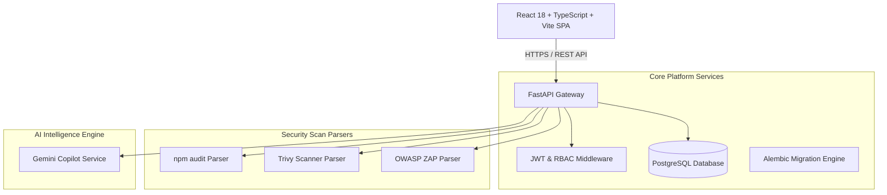

# SentinelDesk Architecture Specification

## Overview

SentinelDesk is a multi-tenant cybersecurity SaaS platform built for vulnerability management, security incident response, scan ingestion, and AI-assisted remediation.

## Data Isolation & Multi-Tenancy

Every domain entity (`Application`, `Vulnerability`, `Incident`, `ScanImport`, `Notification`) belongs to a `Workspace`. Cross-workspace isolation is enforced by the FastAPI dependency `get_current_workspace`, checking workspace membership before querying or mutating resources.
